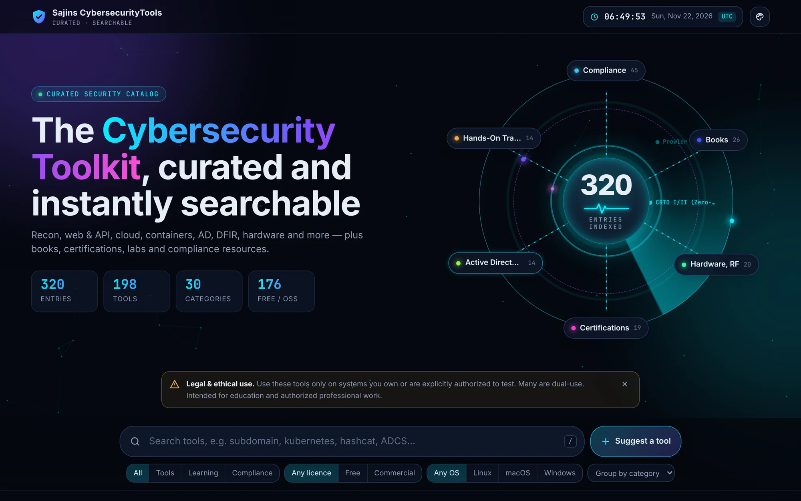
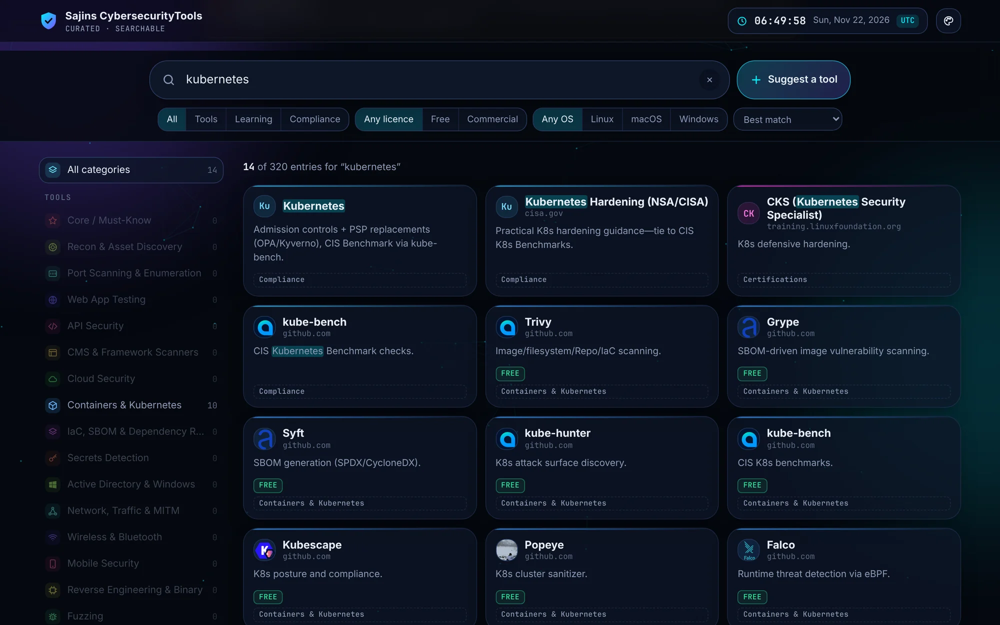
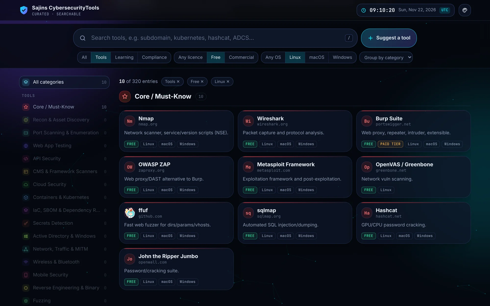
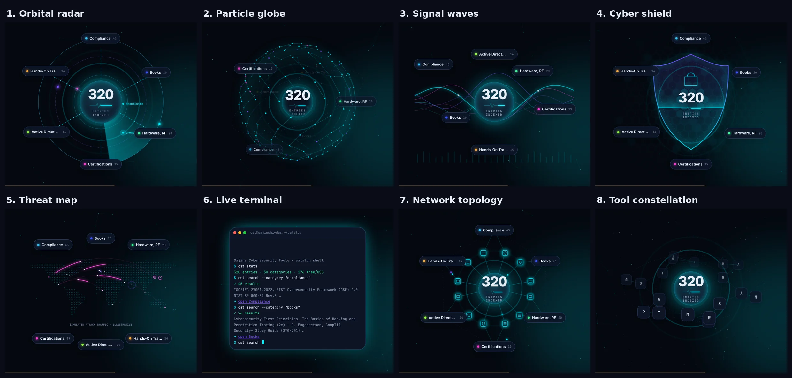
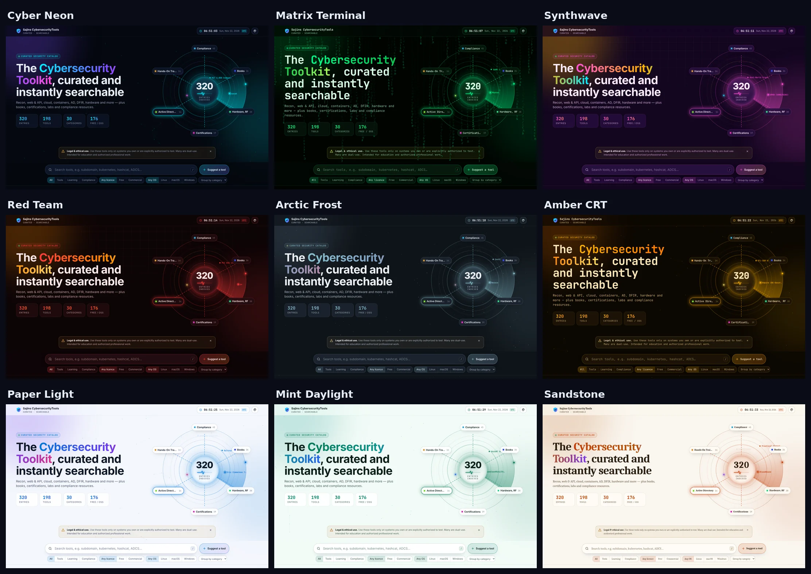
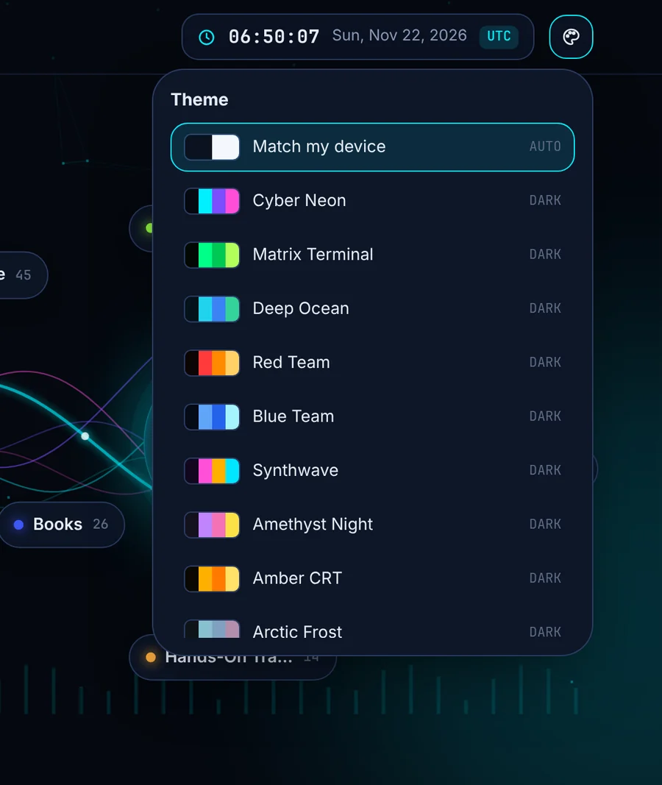
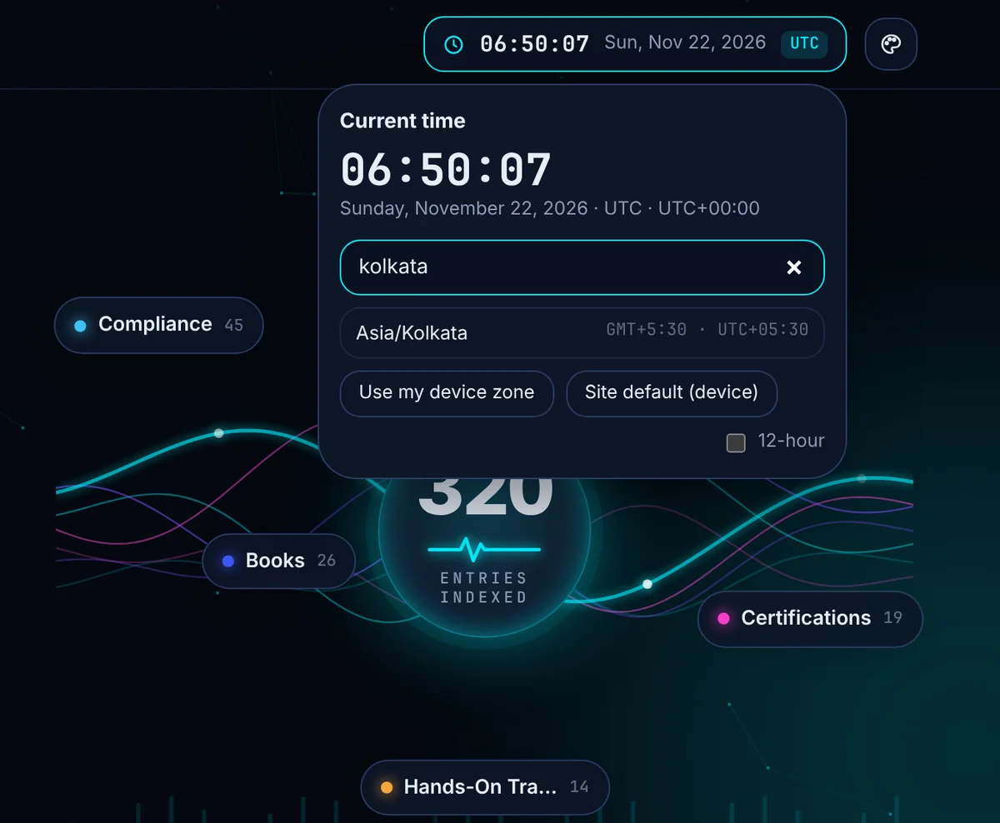
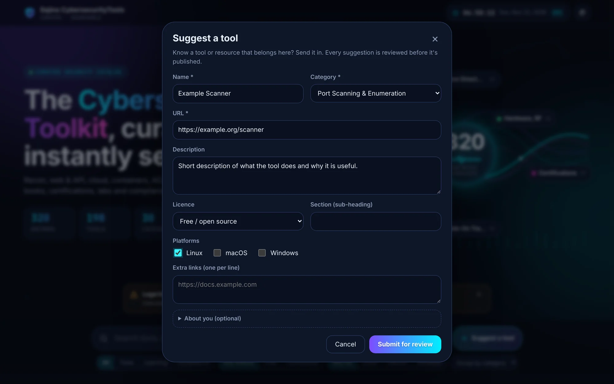
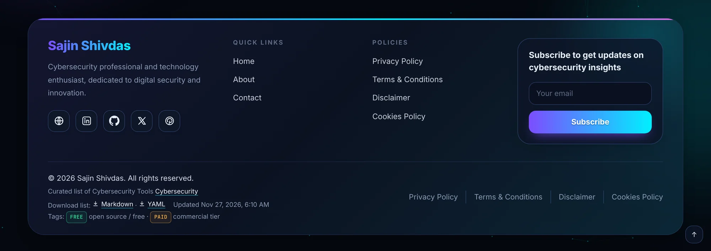
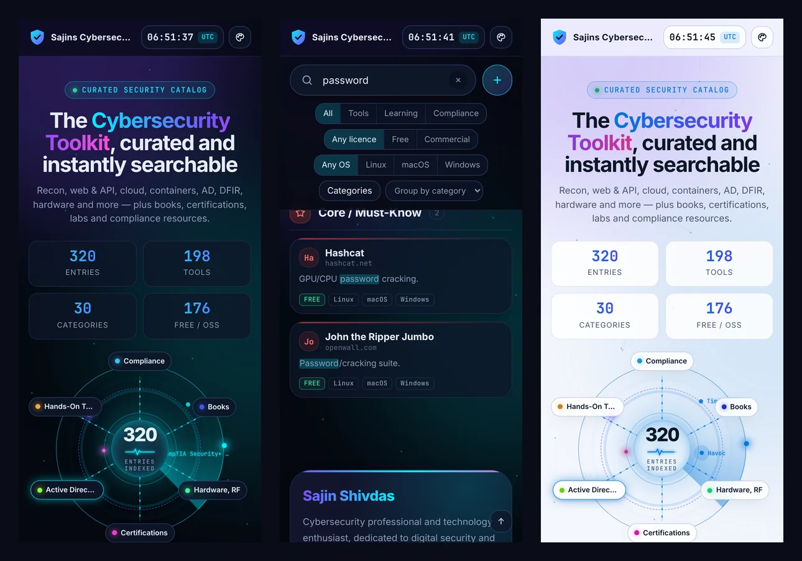

<div align="center">

# Sajin Cybersecurity Toolkit

**A curated, instantly searchable catalog of cybersecurity tools, books, certifications, labs and compliance resources.**

[**Open the website → cybersecuritytools.sajinshivdas.online**](https://cybersecuritytools.sajinshivdas.online)

</div>



---

## Contents

- [What it is](#what-it-is)
- [Highlights](#highlights)
- [Searching](#searching)
- [Filters, categories and sorting](#filters-categories-and-sorting)
- [Tool cards](#tool-cards)
- [Animated hero (8 styles)](#animated-hero-8-styles)
- [Themes and appearance](#themes-and-appearance)
- [Clock and time zones](#clock-and-time-zones)
- [Suggest a tool](#suggest-a-tool)
- [Footer, updates and downloads](#footer-updates-and-downloads)
- [Mobile](#mobile)
- [Shareable links (URL parameters)](#shareable-links-url-parameters)
- [Keyboard shortcuts](#keyboard-shortcuts)
- [Open data](#open-data)
- [Accessibility, performance and privacy](#accessibility-performance-and-privacy)
- [Legal and ethical use](#legal-and-ethical-use)
- [Contributing](#contributing)
- [Credits](#credits)

---

## What it is

The toolkit is a single-page website listing **300+ hand-picked entries in 30 categories**, grouped into three sections:

| Group | What you'll find |
|---|---|
| **Tools** | Core must-knows, recon and asset discovery, port scanning, web app and API testing, CMS scanners, cloud, containers and Kubernetes, IaC / SBOM / dependency risk, secrets detection, Active Directory and Windows, network and MITM, wireless and Bluetooth, mobile, reverse engineering, fuzzing, credentials and passwords, OSINT and threat intel, phishing simulation, C2 and post-exploitation, vulnerability management, DFIR and forensics, tunnelling and pivoting, helpers and utilities, hardware and RF |
| **Learning** | Books, certifications, hands-on training platforms, labs and CTFs |
| **Compliance** | GRC frameworks, policies, control catalogs and technical compliance and benchmark scanners |

Every entry has a short description, its website, a licence tag (free/open source or commercial) and the platforms it runs on. Everything is searchable as you type.

## Highlights

- ⚡ **Instant search** across names, descriptions, categories, sections, websites and platforms, with matches highlighted.
- 🧭 **Filters** by group, licence and operating system, plus a category sidebar with live counts.
- 🎛️ **Eight animated hero styles**, from an orbital radar to a live terminal and a threat map.
- 🎨 **13 themes** (10 dark, 3 light) plus *Match my device*, all with matching background effects.
- 🕒 **Header clock** showing time, date and time zone, with a searchable time-zone picker.
- ➕ **Suggest a tool**: anyone can propose an addition, and every suggestion is reviewed before it's published.
- 🔗 **Shareable URLs**: every search and filter combination is a link you can bookmark or send.
- 📥 **Open data** downloads in Markdown, YAML and JSON.
- 📱 **Fully responsive**, keyboard-friendly, honours *reduced motion*, and loads in a single request.

---

## Searching



- Results update **as you type**.
- **Several words narrow the search**: every word must match, so `kubernetes benchmark` finds entries mentioning both.
- Results are **ranked**: exact name matches first, then names starting with your word, then name words, then descriptions and other fields.
- Matching words are **highlighted** in names, websites and descriptions.
- The result bar shows how many of the entries match, for example *14 of 320 entries for “kubernetes”*.
- Press <kbd>/</kbd> anywhere to jump to the search box, and <kbd>Esc</kbd> to clear it.

## Filters, categories and sorting



| Control | Options |
|---|---|
| **Group** | All · Tools · Learning · Compliance |
| **Licence** | Any licence · Free · Commercial |
| **Platform** | Any OS · Linux · macOS · Windows |
| **Sort** | Group by category · Best match · A → Z |
| **Categories sidebar** | Pick one category. Each shows how many entries match your current search and filters. On phones the list opens from the **Categories** button. |

Active filters appear as **chips** next to the result count. Click a chip's **✕** to remove it.

## Tool cards

Each entry is shown as a card with:

- **Icon**: the tool's own site icon (or initials when none is available), with names and websites at a glance.
- **Description**: what the tool does and why it's useful. Inline code is styled.
- **Licence tags**: `FREE` (free or open source), `PAID` (commercial), or `FREE` + `PAID TIER`.
- **Platform tags**: `Linux`, `macOS`, `Windows`.
- **Category tag** (when searching across categories) and **extra links** such as documentation.
- Click anywhere on the card to open the tool's website in a new tab.

---

## Animated hero (8 styles)

The right side of the header area holds an animated visual. Its centre counts up to the number of entries, and the six largest categories orbit as **clickable chips**: click one to jump straight to that category.



| # | Style | What moves |
|---|---|---|
| 1 | **Orbital radar** | A rotating sweep lights up each category chip as it passes; tool names flash up as *blips*; a heartbeat line pulses in the core; satellites orbit and data flows along the links. |
| 2 | **Particle globe** | A 3D sphere of linked points rotates with signals travelling between them; the chips ride on the surface and fade as they turn to the back. |
| 3 | **Signal waves** | Layered glowing waves with light pulses running along them; the chips ride the crests above equaliser bars. |
| 4 | **Cyber shield** | A glowing shield with a scan line and padlock over a hex grid whose cells light up in rings. |
| 5 | **Threat map** | A dotted world map with animated attack arcs between cities and impact ripples. It is clearly labelled *simulated · illustrative*: it is not live attack data. |
| 6 | **Live terminal** | A terminal types catalog queries and prints real results; each result has a link that opens that category. |
| 7 | **Network topology** | A core linked to servers, firewalls and laptops and to the category hubs, with packets moving along the links. |
| 8 | **Tool constellation** | Icons of real tools from across the catalog drift on tilted orbits and link up when close; hover for the name, click to search for it. |

All styles use the active theme's colours, pause when scrolled out of view, and stay still for visitors who prefer reduced motion. To view a specific style, add `?hero=` to the address (see [URL parameters](#shareable-links-url-parameters)).

## Themes and appearance





Open the **palette button** in the top-right corner to switch theme. Your choice is remembered in your browser.

**Dark:** Cyber Neon · Matrix Terminal · Deep Ocean · Red Team · Blue Team · Synthwave · Amethyst Night · Amber CRT · Arctic Frost · High Contrast

**Light:** Paper Light · Mint Daylight · Sandstone

**Match my device** follows your system's light or dark setting automatically.

Each theme brings its own colours, fonts and a background effect:
- a **network** of drifting nodes,
- **falling code**,
- a **cyber grid**,
- a **starfield**,
- or none.

High Contrast is designed for maximum readability.

<br clear="right">

## Clock and time zones



The header clock shows the **current time, date and time zone**. Click it to open the time-zone picker:

- **Search** any time zone by city, region or offset, for example `kolkata`, `dubai` or `+05:30`. Modern names are shown, so you see *Asia/Kolkata*, not *Asia/Calcutta*.
- **Use my device zone** or go back to the **site default**.
- Switch between **12-hour and 24-hour** time.
- Your choice is remembered in your browser.

<br clear="right">

---

## Suggest a tool



Know something that belongs in the catalog? Click **➕ Suggest a tool** next to the search bar.

- **Required:** the tool's **name**, its **website**, and a **category**. You can also propose a **new category**.
- **Optional:** a description, licence, section, platforms and extra links. Under *About you* you can add your name, an email and a note for the reviewer; your email is used only for this suggestion.
- If the website is **already in the catalog**, the form tells you straight away (for example *Already listed as “Nmap” in Core / Must-Know*).
- **Every suggestion is reviewed** before it appears on the site.

## Footer, updates and downloads



The footer has:
- **Author and links:** the author's details and social links, quick links and the site's policy pages.
- **Subscribe box:** subscribe for updates on cybersecurity insights.
- **Downloads and status:** download links for the full list, the date the catalog was last updated, and a legend for the licence tags.

## Mobile



The layout adapts to any screen:
- the hero animation sits below the headline,
- the category list opens from a button,
- the *Suggest a tool* button collapses to a **＋** icon,
- every popup fits the screen.

---

## Shareable links (URL parameters)

Every search and filter is reflected in the address bar, so you can bookmark or share an exact view. You can also build links by hand:

| Parameter | Values | Example |
|---|---|---|
| `q` | Any search text | `?q=subdomain` |
| `cat` | A category's slug, as set when you pick a category | `?cat=cloud-security` |
| `kind` | `tools`, `learn`, `grc` | `?kind=learn` |
| `lic` | `F` (free), `C` (commercial) | `?lic=F` |
| `os` | `Linux`, `macOS`, `Windows` | `?os=Linux` |
| `sort` | `cat` (by category), `rel` (best match), `az` (A → Z) | `?q=burp&sort=rel` |
| `theme` | `cyber`, `matrix`, `ocean`, `redteam`, `blueteam`, `synthwave`, `amethyst`, `amber`, `arctic`, `contrast`, `paper`, `mint`, `sand` | `?theme=paper` |
| `hero` | `radar`, `globe`, `waves`, `shield`, `map`, `terminal`, `topology`, `constellation`, `none` | `?hero=terminal` |

Parameters combine. For example, this link shows free Linux tools matching "password", sorted by best match:
`https://cybersecuritytools.sajinshivdas.online/?q=password&kind=tools&lic=F&os=Linux&sort=rel`

## Keyboard shortcuts

| Key | Action |
|---|---|
| <kbd>/</kbd> | Focus the search box |
| <kbd>Esc</kbd> | Clear the search (in the search box) · close the clock, theme or suggestion popups |
| <kbd>Enter</kbd> | In the time-zone search: pick the first match |
| <kbd>Tab</kbd> | Every control, card, chip and popup is reachable by keyboard |

## Open data

The whole catalog can be downloaded and reused:

| URL | Format |
|---|---|
| [`/catalog.md`](https://cybersecuritytools.sajinshivdas.online/catalog.md) | Markdown, readable list grouped by category |
| [`/catalog.yaml`](https://cybersecuritytools.sajinshivdas.online/catalog.yaml) | YAML, structured |
| [`/catalog.json`](https://cybersecuritytools.sajinshivdas.online/catalog.json) | JSON, structured (same shape as the YAML) |

<details>
<summary>YAML format example</summary>

```yaml
kind: catalog
version: 1
groups:
  - id: tools
    label: Tools
categories:
  - title: Core / Must-Know
    group: tools
    icon: core
    items:
      - name: Nmap
        url: https://nmap.org
        description: Network scanner, service/version scripts (NSE).
        license: free          # free | commercial | free/commercial
        platforms: [Linux, macOS, Windows]
        section: Optional sub-heading
        links:
          - https://nmap.org/book/
```
</details>

## Accessibility, performance and privacy

**Fast:**
- The catalog is embedded in the page, so it loads in **one request**, compressed.
- There's no front-end framework.
- Animations use the GPU and pause when off-screen or in a background tab.

**Accessible:**
- Semantic HTML, labelled controls and visible focus rings.
- Full keyboard support.
- **Reduced-motion** preferences are honoured.
- A High Contrast theme is available.

**Private:**
- There are no analytics, trackers or ads, and no third-party scripts. A strict Content Security Policy blocks anything else.
- Your theme, time zone, 12/24-hour choice and dismissed notices are stored only in **your own browser**.
- Tool icons are fetched from the DuckDuckGo icon service.
- Contact details you give when suggesting a tool or subscribing are used only for that purpose.

## Legal and ethical use

> **Use these tools only on systems you own or are explicitly authorized to test.** Many are dual-use. The catalog is intended for education and authorized professional work. Listing a tool is not an endorsement, and each tool is governed by its own licence and terms.

## Contributing

- **Add a tool:** use **Suggest a tool** on the [website](https://cybersecuritytools.sajinshivdas.online). This is the quickest way, and suggestions are reviewed before publishing.
- **Report a problem or idea:** open an [issue](https://github.com/ShivdaSaj/Sajin-Cybersecurity-Toolkit/issues), for example a broken link, a wrong description or a feature request.

## Credits

- **Curated by:** Sajin Shivdas, [sajinshivdas.online](https://sajinshivdas.online).
- **Third-party code:** [js-yaml](https://github.com/nodeca/js-yaml) (MIT).
- **Tool names, logos and trademarks** belong to their respective owners.
